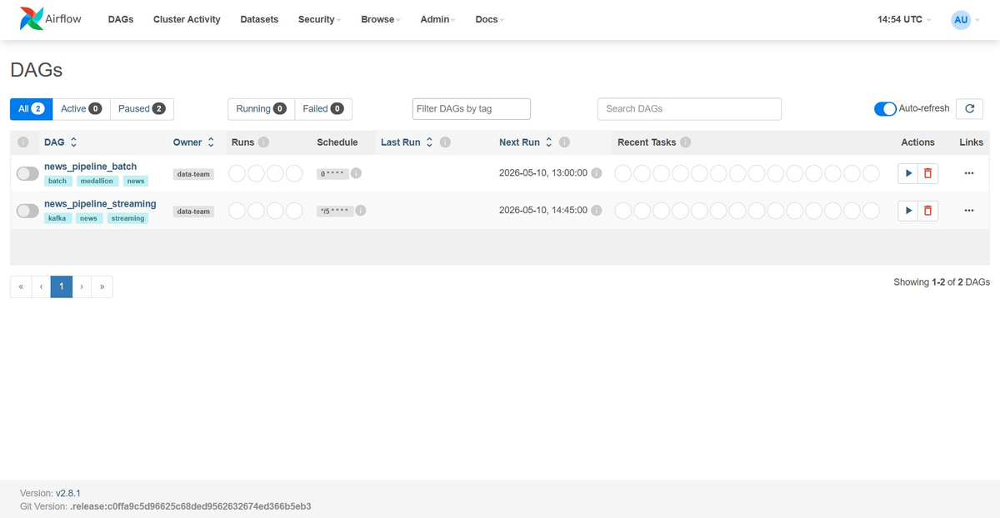
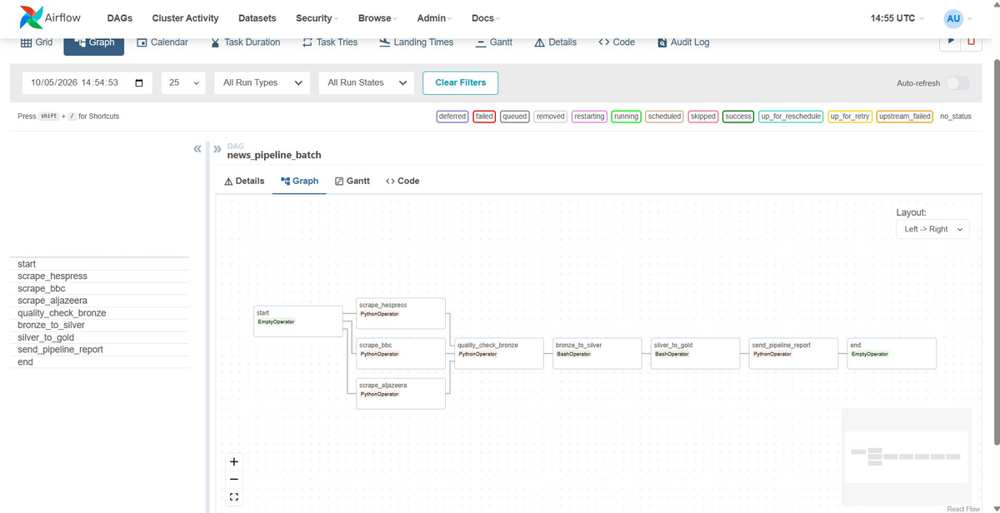
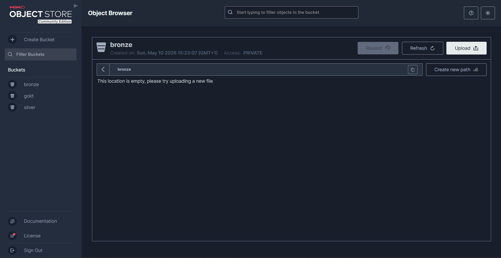
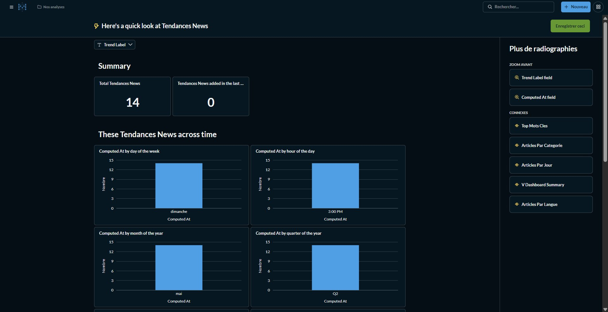

# 📰 News Big Data Platform — Airflow · Kafka · Spark · MinIO · Metabase

     

> Plateforme Big Data de collecte et d'analyse d'articles de presse — EMSI Casablanca | IADATA 2025/2026

**EN —** End-to-end news data platform: scrapers (Hespress, BBC, Al Jazeera) feed a **medallion lakehouse** (Bronze/Silver/Gold on MinIO) through **batch (Airflow)** and **streaming (Kafka)** ingestion; **PySpark** handles the ETL, 7 automated **data-quality** checks and a governance layer (catalogue + lineage) run on each load, Gold tables land in **PostgreSQL** and are visualised in **Metabase**. The whole stack starts with one `docker-compose up`.

---

## 📸 Aperçu

| Airflow — DAGs batch & streaming | Graphe du DAG batch |
|---|---|
|  |  |
| **MinIO — buckets Bronze / Silver / Gold** | **Metabase — tendances** |
|  |  |

---

## 🏗️ Architecture globale

```
Sources Web                Ingestion               Data Lake (MinIO)              DWH
──────────────     ─────────────────────     ──────────────────────────     ──────────────
Hespress        ──►  Batch (Airflow)     ──►  Bronze (JSON brut)        ──►  PostgreSQL
BBC News        ──►  Streaming (Kafka)   ──►  Silver (Parquet propre)       gold.*
Al Jazeera                               ──►  Gold (Parquet analytique)
                                                                         Visualisation
                                                                         ──────────────
                                                                         Metabase
```

### Architecture Médaillon

| Couche  | Format  | Contenu                          | Stockage           |
|---------|---------|----------------------------------|--------------------|
| Bronze  | JSON    | Articles bruts, HTML inclus      | MinIO `bronze/`    |
| Silver  | Parquet | Nettoyé, normalisé, dédupliqué   | MinIO `silver/`    |
| Gold    | Parquet | Tables analytiques agrégées      | MinIO `gold/` + PG |

---

## 📦 Stack technique

| Composant     | Technologie              | Rôle                          |
|---------------|--------------------------|-------------------------------|
| Scraping      | Python + BeautifulSoup + feedparser | Collecte des articles |
| Streaming     | Apache Kafka             | Ingestion événementielle      |
| Data Lake     | MinIO (compatible S3)    | Stockage distribué            |
| Transformation| Apache Spark (PySpark)   | ETL Bronze→Silver→Gold        |
| Orchestration | Apache Airflow           | Planification des pipelines   |
| Data Warehouse| PostgreSQL               | Tables analytiques            |
| Visualisation | Metabase                 | Dashboards interactifs        |
| Conteneurisation | Docker + Docker Compose | Déploiement unifié          |

---

## 🚀 Démarrage rapide

### Prérequis

- Docker ≥ 24.0
- Docker Compose ≥ 2.20
- 8 Go de RAM minimum alloués à Docker
- Ports libres : 3000, 5432, 7077, 8081, 8082, 9000, 9001, 29092

### Lancement

```bash
# 1. Cloner et entrer dans le projet
git clone <repository-url>
cd news-bigdata-platform

# 2. Démarrer tous les services
docker-compose up -d

# 3. Attendre l'initialisation (~2 minutes)
docker-compose logs -f airflow-init

# 4. Vérifier que tout est up
docker-compose ps
```

### Accès aux interfaces

| Service        | URL                        | Credentials         |
|----------------|----------------------------|---------------------|
| Airflow UI     | http://localhost:8082       | admin / admin123    |
| MinIO Console  | http://localhost:9001       | minioadmin / minioadmin |
| Spark UI       | http://localhost:8081       | —                   |
| Metabase       | http://localhost:3000       | (config initiale)   |
| PostgreSQL     | localhost:5432              | newsuser / newspass |

---

## 📁 Structure du projet

```
news-bigdata-platform/
├── scrapers/
│   ├── hespress_scraper.py      # Scraper Hespress (Maroc)
│   ├── bbc_scraper.py           # Scraper BBC News (RSS)
│   ├── aljazeera_scraper.py     # Scraper Al Jazeera (RSS)
│   └── run_scrapers.py          # Runner batch + streaming
│
├── medallion/
│   ├── bronze/
│   │   └── bronze_layer.py      # Ingestion → MinIO Bronze
│   ├── silver/
│   │   └── silver_layer.py      # PySpark: nettoyage & normalisation
│   └── gold/
│       └── gold_layer.py        # PySpark: tables analytiques
│
├── dags/
│   ├── news_pipeline_batch.py    # DAG batch (toutes les heures)
│   └── news_pipeline_streaming.py # DAG streaming (toutes les 5 min)
│
├── quality/
│   └── data_quality.py          # Tests: complétude, cohérence, validité
│
├── governance/
│   └── data_governance.py       # Catalogue + Lineage
│
├── docker/
│   └── postgres/
│       ├── init.sql             # Schéma DWH Gold
│       └── seed_gold.sql        # Données Gold de démonstration (dashboards)
│
├── docs/                        # Rapport (.docx), présentation (.pptx), captures
├── Dockerfile                   # Image du service de scraping
├── requirements.txt
├── docker-compose.yml           # Stack complète
└── README.md
```

---

## 🔄 Pipelines

### Batch (toutes les heures)

```
Airflow scheduler
  └─► scrape_hespress ─┐
  └─► scrape_bbc      ─┼─► quality_check_bronze ─► bronze_to_silver ─► silver_to_gold ─► report
  └─► scrape_aljazeera ┘
```

### Streaming (toutes les 5 minutes)

```
Scrapers ─► Kafka (topic: news.raw) ─► Consumer ─► Bronze ─► Silver (micro-batch)
```

---

## 📊 Données collectées

Chaque article contient :

| Champ          | Description                        |
|----------------|------------------------------------|
| `id`           | Hash MD5 de l'URL (identifiant unique) |
| `title`        | Titre de l'article                 |
| `author`       | Auteur / rédaction                 |
| `published_at` | Date de publication (ISO 8601)     |
| `category`     | Catégorie éditoriale               |
| `content`      | Corps de l'article (texte propre)  |
| `source`       | Site source                        |
| `url`          | URL canonique                      |
| `language`     | Langue détectée (ar/en/fr)         |
| `scraped_at`   | Timestamp de collecte              |

### Sources configurées

- **Maroc** : Hespress (scraping direct, 5 catégories)
- **International** : BBC News (RSS), Al Jazeera (RSS)

---

## ✅ Qualité des données

Tests automatisés à chaque run :

| Test                | Dimension    | Description                           |
|---------------------|-------------|---------------------------------------|
| `titre_absent`      | Complétude  | Titre présent et ≥ 5 caractères       |
| `date_manquante`    | Complétude  | Date présente, parsable et non future |
| `contenu_court`     | Validité    | Contenu ≥ 100 caractères             |
| `url_invalide`      | Validité    | URL http/https valide                 |
| `source_inconnue`   | Cohérence   | Source dans la liste reconnue         |
| `langue_inconnue`   | Cohérence   | Langue dans les codes valides         |
| `doublon_url`       | Cohérence   | Pas de doublons d'URL dans le lot     |

---

## 📈 Tables Gold (Data Warehouse)

| Table                   | Description                              |
|-------------------------|------------------------------------------|
| `articles_par_jour`     | Volume quotidien par source              |
| `articles_par_categorie`| Distribution thématique                  |
| `articles_par_langue`   | Répartition linguistique                 |
| `top_mots_cles`         | 200 mots les plus fréquents             |
| `tendances_news`        | Score tendance (7j vs 30j) par catégorie |

---

## 📊 Dashboards Metabase (données de démonstration)

1. Ouvrir http://localhost:3000 et créer le compte administrateur.
2. Ajouter une base **PostgreSQL** : host `postgres`, port `5432`, base `newsdb`, user `newsuser`, mot de passe `newspass`.
3. (Optionnel) Charger des données Gold simulées pour tester les dashboards :

```bash
docker cp docker/postgres/seed_gold.sql news-postgres:/seed_gold.sql
docker exec -i news-postgres psql -U newsuser -d newsdb -f /seed_gold.sql
```

> Les données de `seed_gold.sql` sont **simulées** ; le pipeline Airflow alimente les mêmes tables avec des données réelles.

## 🔧 Dépannage

- **Login Airflow refusé** : `docker exec news-airflow-webserver airflow users create --username admin --firstname Admin --lastname User --role Admin --email admin@emsi.ma --password admin123`
- **Metabase ne démarre pas** (base manquante) : `docker exec news-postgres psql -U airflow -c "CREATE DATABASE metabase;"` puis `docker restart news-metabase`.
- **Conflit de ports / noms de conteneurs** : arrêter les autres stacks Docker (`docker ps`).

> ⚠️ Les identifiants du `docker-compose.yml` sont des valeurs de **démonstration** : à changer pour tout usage hors développement.

---

## 🛑 Arrêt

```bash
# Arrêt des services (données conservées)
docker-compose down

# Arrêt + suppression des volumes (reset complet)
docker-compose down -v
```

---

## 👥 Équipe

Projet réalisé dans le cadre du cours **Architecture de données** — Filière IADATA, EMSI Casablanca, AU 2025/2026.

- Ali Elfanity
- Houssam Bouhou
- Alami Hassani Mohamed
